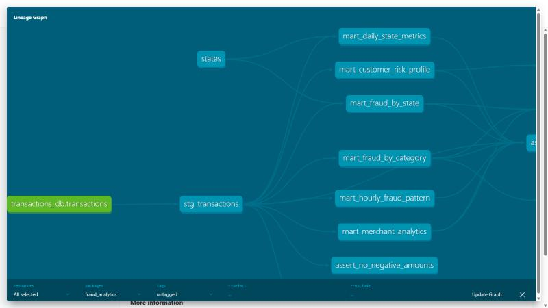

# dbt-проект: аналитика фрода на ClickHouse

Слоистая модель данных поверх таблицы `transactions_db.transactions` (транзакции с признаком фрода из ДЗ по ClickHouse).

```
raw (source: transactions_db.transactions) → staging (stg_transactions) → marts (6 витрин)
                         seed: states ───────┘
```



## Версии

| Пакет | Версия |
|-------|--------|
| dbt-core | 1.9.11 |
| dbt-clickhouse | 1.10.3 |
| ClickHouse | 24.8 |
| dbt_utils / dbt_date / dbt_expectations | см. `packages.yml` |
| sqlfluff + sqlfluff-templater-dbt | 3.2.5 |

## Запуск

Все команды — из каталога `dbt/`. Нужны Docker и Python 3.10+. Файл `train.csv` из ДЗ по ClickHouse должен лежать в `../data/train.csv`.

```bash
make install   # pip install -r requirements.txt
make up        # поднять ClickHouse (docker compose из корня репозитория)
make load      # создать transactions_db.transactions и загрузить в неё data/train.csv
make all       # dbt deps && dbt seed && dbt run && dbt test
make docs      # dbt docs generate && dbt docs serve (http://localhost:8080)
make lint      # sqlfluff lint
```

Без make:

```bash
export DBT_PROFILES_DIR=.
dbt deps && dbt seed && dbt run && dbt test
```

`profiles.yml` лежит в проекте и по умолчанию подключается к `localhost:8123`, пользователь `default` без пароля. Значения переопределяются переменными `CLICKHOUSE_HOST`, `CLICKHOUSE_PORT`, `CLICKHOUSE_USER`, `CLICKHOUSE_PASSWORD`.

Слои пишутся в отдельные базы ClickHouse: `staging` (view `stg_transactions`, seed `states`) и `marts` (таблицы витрин).

## Модели

**`stg_transactions`** (staging, view):
- приведение типов, trim и нормализация регистра;
- имя мерчанта без префикса `fraud_`;
- суррогатные ключи `transaction_id` и `customer_id` через `dbt_utils.generate_surrogate_key`;
- `day_of_week` через `dbt_date.day_of_week`;
- `amount_bucket` через собственный макрос;
- флаг крупной транзакции и расстояние клиент — мерчант;
- отбрасываются полные дубли и неположительные суммы.

**Витрины (marts, table):**

| Витрина | Что показывает |
|---------|----------------|
| `mart_daily_state_metrics` | дата × штат: число транзакций, сумма, средний чек, P95, доля крупных (≥ 500 USD) |
| `mart_fraud_by_category` | по категориям: транзакции, фроды, fraud_rate (%), суммы, ранг категории по риску |
| `mart_fraud_by_state` | по штатам: fraud_rate, уникальные клиенты и мерчанты, суммы, название и регион из seed |
| `mart_customer_risk_profile` | по клиентам: история (первая/последняя транзакция, количество), fraud_rate, средний чек, сегмент HIGH/MEDIUM/LOW |
| `mart_hourly_fraud_pattern` | день недели × час (168 слотов): fraud_rate, отношение к среднему, флаг окна повышенного риска |
| `mart_merchant_analytics` | по мерчантам: оборот, средний чек, fraud_rate, флаг подозрительности |

Сегмент риска клиента: HIGH — 3 и больше фродовых транзакций или fraud_rate ≥ 10%, MEDIUM — хотя бы одна фродовая транзакция, LOW — без фрода. Подозрительный мерчант — от 20 транзакций и fraud_rate в 3+ раза выше среднего по мерчантам. Окно повышенного риска — слот с fraud_rate минимум вдвое выше среднего.

## Макросы

| Макрос | Назначение |
|--------|-----------|
| `amount_bucket(column)` | сегментация суммы: micro / small / medium / large / huge (граница huge — `var('large_amount_threshold')`) |
| `fraud_rate(fraud_col, precision)` | доля фрода в процентах, используется во всех витринах |
| `clickhouse__date_part` | реализация `dbt_date.date_part` для ClickHouse (подключена через `dispatch` в `dbt_project.yml`) |
| `generate_schema_name` | слои пишутся в базы `staging` и `marts` без префикса |

## Тесты

`dbt test`: 57 проверок, все проходят. Лог — [`docs/dbt_test.log`](docs/dbt_test.log).

- **Generic** (`schema.yml`, `stg_transactions.yml`, `sources.yml`): `not_null`, `unique`, `accepted_values`, `relationships` (штаты → seed `states`).
- **dbt_utils:** `unique_combination_of_columns` для ключей витрин (дата × штат, день недели × час), `accepted_range`.
- **dbt_expectations:** `expect_table_row_count_to_be_between`, `expect_table_row_count_to_equal` (168 слотов), `expect_column_values_to_be_between`, `expect_column_distinct_count_to_equal` (14 категорий).
- **Singular** (`tests/`):
  - `assert_no_negative_amounts` — в staging нет неположительных сумм;
  - `assert_fraud_rate_bounds` — fraud_rate во всех витринах в пределах [0, 100];
  - `assert_marts_reconcile_with_staging` — каждая витрина в сумме даёт столько же транзакций и фродов, сколько staging;
  - `assert_amount_bucket_matches_amount` — сегмент из макроса согласован с суммой.
- **Unit tests** (dbt 1.8+, в `models/marts/schema.yml`):
  - `test_fraud_by_category_rate` — расчёт fraud_rate и ранга категорий;
  - `test_customer_risk_segments` — сегментация клиентов HIGH/MEDIUM/LOW.

  Запуск только unit-тестов: `make unit`.

## Линтинг и pre-commit

- `.sqlfluff` — диалект `clickhouse`, templater `dbt`, ключевые слова в нижнем регистре, явные алиасы. Регистр функций (CP03) не проверяется: в ClickHouse имена функций чувствительны к регистру (`uniqExact`, `toUInt8`).
- `../.pre-commit-config.yaml` — базовые хуки, `sqlfluff-lint` на каждый коммит и `sqlfluff-fix` вручную (`pre-commit run sqlfluff-fix --hook-stage manual`).

```bash
pip install pre-commit && pre-commit install
```
